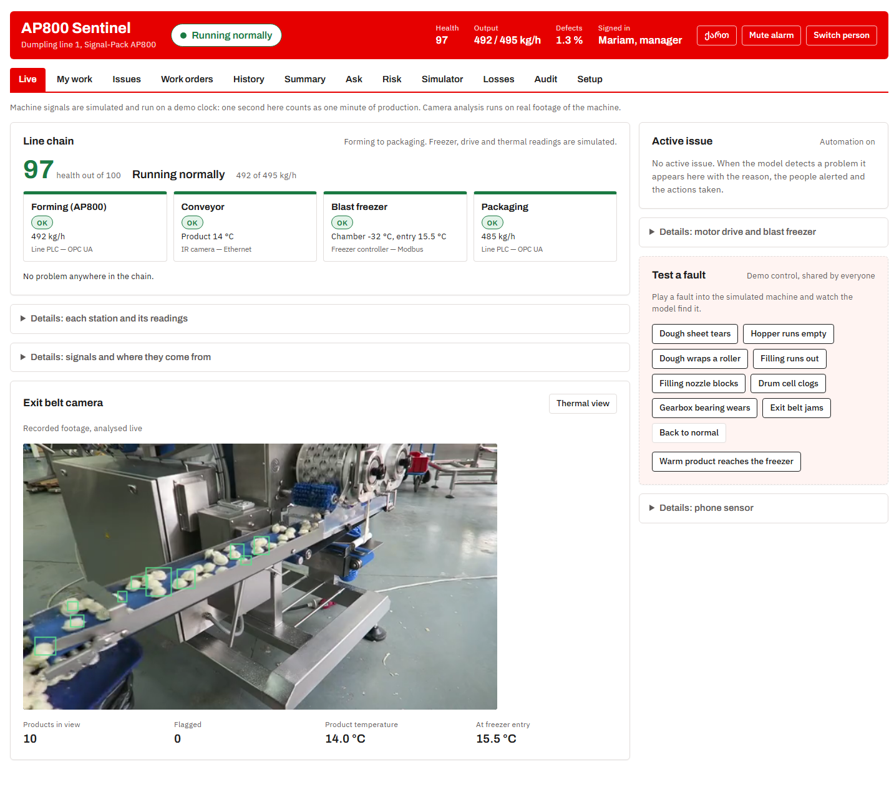
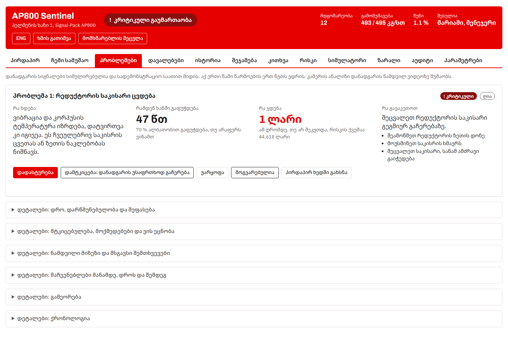

# AP800 Sentinel

Fault detection and monitoring for a Signal-Pack AP800 dumpling machine, built in one day at a hackathon.

**Live demo:** https://ap800-sentinel.onrender.com

The demo sleeps after about 15 minutes without visitors, so the first visit can take up to a minute. Each wake starts with a clean database.



## What it does

- **Watches the line.** Fifteen machine signals are checked twice a second by a hand-written Isolation Forest. The signals are simulated; the camera view analyses real footage of the machine.
- **Names the fault and explains it.** Eight trained faults are classified, with the readings behind the diagnosis, the time left before failure and the money lost so far.
- **Gets the right person.** Alerts go to the operator, then the technician, then the manager if nobody acknowledges within 20 seconds.
- **Acts with guardrails.** Low-risk actions run on their own. Stopping the machine waits for a manager's approval, and every step is kept in an append-only history.
- **Admits what it does not know.** Suspect sensors, single-sensor diagnoses and unfamiliar patterns are shown as such instead of being forced into a named fault.
- **Covers the rest of the job.** Work orders, a what-if simulator, risk projection, key figures (OEE, MTBF, MTTR), reports and a Georgian or English interface.



## How it is built

| Part | Technology |
|---|---|
| Server | Node.js with no npm packages |
| Database | SQLite through `node:sqlite` |
| Detection | Isolation Forest and a nearest-centroid classifier, written from scratch |
| Interface | Plain HTML, CSS and JavaScript, no build step |
| Tests | `node:test`, 77 tests |
| Hosting | Render |

## Run

```
npm start
```

Open http://localhost:4800 and choose a person to sign in as. Needs Node 22.13 or newer. No packages to install.

| Command | What it does |
|---|---|
| `npm start` | Runs the website, the simulated machine and the detection engine |
| `npm test` | Runs the test suite (77 tests) |
| `npm run train` | Retrains the detection model on fresh synthetic data. Restart the server afterwards |
| `npm run reset` | Deletes the database so the next start is clean |

## Environment variables

Copy `.env.example`. All are optional.

| Variable | Default | Meaning |
|---|---|---|
| `PORT` | 4800 | Port of the website |
| `ESCALATE_AFTER_S` | 20 | Seconds before an unacknowledged issue goes to the next person |
| `TELEGRAM_BOT_TOKEN` | empty | Without it, Telegram messages are recorded but not sent |
| `API_TOKEN` | empty | Token for the read-only REST API. Empty keeps the API off |
| `DB_PATH` | `data/sentinel.db` | SQLite database file |

## What is real and what is not

- **Simulated:** all machine signals. There is no connection to a real AP800.
- **Real code on simulated data:** the Isolation Forest model, fault classification, explanations, issue lifecycle, escalation, approval guardrails, loss calculation, history.
- **Real data:** the exit-belt camera analysis runs on a 25-second clip of the actual machine. The phone sensor page reads a real accelerometer.
- **Placeholders:** people, shifts, cost figures, the assumed kit cost used for ROI.
- **Mock:** machine control. Commands are recorded and stop the simulated machine. Telegram is not sent.
- **Demo clock:** one real second counts as one minute of production for durations and money.
- **Sign-in:** pick a person, no password. Not suitable for real use.

Model metrics are measured on synthetic test data from the same simulator. They say nothing about accuracy on a real machine.

## Roles

| Role | Can do |
|---|---|
| Operator | See everything except money and setup, acknowledge issues, use the fault test buttons |
| Technician | Also resolve issues and run low-risk actions |
| Manager | Also approve or undo machine actions, verify repairs, see losses, change settings and costs |

## Demo script

1. Sign in as Mariam (manager). Wait for "Running normally".
2. On Live, press "Gearbox bearing wears". In about 3 seconds an issue opens with the reason, the readings behind it, time to failure, and the loss so far.
3. Low-risk actions are already done. "Shut the machine down safely" waits for approval. Leave it for 20 seconds to show escalation to the next person.
4. Approve the shutdown. The machine stops and downtime starts costing money.
5. Type what was fixed and press "Mark resolved". The machine restarts.
6. Open the issue's full record, then Losses, History and Summary.
7. In a second browser, sign in as Nino (operator) to show that Losses and Setup are hidden and approval is refused.

## Simulations and risk (Phase 2)

- **Simulator tab** (technician and manager): pick a scenario, severity, speed, time of day and response delay. The run happens in a sandbox with its own in-memory database, mock notifiers and a mock actuator. It shows time to detection, who would be alerted, what would run, and the loss if caught early, caught late, or not acted on. Runs are stored in the `simulations` table only and can be replayed and exported.
- **Untrained scenarios**: pressure sensor freezing, dropping out or drifting, a power surge, and a gradual performance drop are in the simulator but not in the model's training data. Each result states plainly whether the model handled it correctly, saw it without understanding it, named the wrong fault, or missed it. Before the cross-check below was added: frozen sensor is missed by the fault model and caught by the activity monitor; drop-out and drift are named as filling faults, which is wrong; a surge is seen as an unclassified anomaly; a performance drop is detected after about an hour and named wrongly.
- **Cross-check** (added after the first results; the model was not retrained): the activity monitor is connected to the fault model.
  - If a sensor is flagged as frozen, out of range, changing impossibly fast, or just back from a data gap, any diagnosis that depends on it is shown as "Possible sensor fault: check the … sensor", with the model's diagnosis listed as "if the sensor is correct". Only a work order to check the sensor is created; no stop is recommended; the technician is alerted as a sensor issue. An issue already open is reclassified and its pending machine action withdrawn.
  - A diagnosis that rests on one sensor while the rest look normal has its confidence lowered and says so. A machine action on a low-confidence diagnosis always needs manager approval and carries a warning. The warning is lifted when other sensors come to agree.
  - Every sensor flag is sent to the technician on duty.
  - The Simulator tab has a before/after table for the five untrained scenarios. After the cross-check: drop-out is correctly shown as a possible sensor fault; a frozen sensor is still missed by the fault model but the technician is now alerted; drift and performance drop are still named wrongly, at lowered confidence and with the machine action held back; a surge is unchanged.
- **Cross-check, round 2** (still no retraining):
  - *Corroboration.* A flagged sensor only turns a diagnosis into a possible sensor fault if no trusted sensor moves the way the fault predicts. If others agree, the fault and its actions stay and the flag is shown as a sensor note. A real blockage at maximum speed and severity stays a blockage.
  - *Unknown-anomaly threshold.* Below a confidence threshold (Setup page, default 40 %, manager-only, audit-logged) no fault is named: the issue is "Unclassified anomaly: inspect the machine" with the top candidate listed as most likely, an inspection work order, a technician alert, and no machine action. It is named later if confidence reaches the threshold.
  - *Warning heeded or ignored.* Where a low-confidence warning decides the outcome, the simulator runs both and shows both losses.
  - *Data gaps* are detected between any two readings, not only after a restart.
  - The Simulator tab compares all thirteen scenarios across three columns: before the cross-check, after round 1, after round 2.
- **Risk tab**: Monte Carlo projection for 7, 30 and 90 days (2,000 random futures), risk ranking, heatmap and loss distribution. Event rates are placeholders that blend with recorded issue history.
- **Unusual activity**: frozen sensor, physically impossible readings (outside the sensor range, or changing faster than the quantity can), energy use while stopped, running outside 06:00 to 22:00, a safeguard switched off, three or more rejected or undone actions in a day, a gap in the data. Each flag can be marked expected, investigated or escalated. Every check has a test button on the Risk tab except the data gap, which appears after a server restart, and the safeguard change, which you trigger on the Setup page. Out-of-range readings are hidden from the fault model. Escalated flags land in the manager's inbox on the Live tab.
- **Assumptions**: event rates, minutes to breakdown, the early-catch rate and bearing age are editable by the manager on the Setup page and labelled "assumed" on the Risk tab.
- Everything simulated or projected is drawn with a dashed violet border and a SIMULATED or PROJECTION tag.

## Maintenance operations (Phase 3)

- **Work orders tab**: every work-order or maintenance action creates a work order linked to its issue. Lifecycle: created, assigned, in progress, completed, verified. Technicians take and work them; the manager assigns and verifies.
- **Maintenance calendar**: each work order gets a suggested window: the earliest slot long enough for the job that avoids peak production (10:00 to 14:00 and 18:00 to 21:00, placeholders) and ends before the deadline. The deadline is the predicted time to failure where there is one, otherwise 2, 8, 24 or 72 hours by severity. If no slot fits, the job is scheduled at once and marked "in peak".
- **Key figures** (Summary tab): OEE, availability, performance, quality, MTBF, MTTR, unplanned stops and downtime for the last hour, 24 hours or 7 days.
- **Knowledge base**: when resolving an issue the technician records root cause, fix, parts and time. New issues of the same type show these past fixes. Searchable on the Issues tab.
- **My work tab**: a phone-width view of the active issue, the person's work orders and unassigned ones, plus a QR code that opens the machine's status page.
- **Spare parts** (Work orders tab): stock per part, linked to issue types. An issue that needs a part at or below its minimum shows a reorder warning with the delivery time. The manager edits stock.
- **Shift handover** (Summary tab): what happened this shift, what is open, and what the next shift should watch.
- **Georgian interface**: the demo screens are in Georgian by default, with a ქართ/ENG button in the header. The strings are in `public/i18n/ka.json`; they were machine-translated and have not been checked by a native speaker. Other screens fall back to English.

## Platform features (Phase 4)

- **Audit tab** (manager): sign-ins, setting changes, approvals, rejections, overrides and automated actions in one list, built from the append-only history. Filter by kind, person or text; export CSV.
- **Model health** (Setup tab): a data drift score checked every 30 seconds of clean running (the largest shift of any signal's average from its training value, in standard deviations), its trend, average confidence, and false alarms reported. The manager is alerted when drift passes the limit (default 2, editable). Technicians mark each issue as a real fault or a false alarm on the issue page. Every issue records the model version that raised it.
- **Reports** (Summary tab, manager): daily and weekly reports as downloadable HTML files, a "send" button, and a schedule (daily at 08:00, weekly on Mondays). Sending goes to a mock notifier: it is recorded, nothing leaves the computer.
- **Ask tab**: answers 13 kinds of question from the app's own records, with links. No AI service. Anything else gets the list of supported questions. Read-only; money answers need the manager.
- **REST API**: read-only `GET /api/v1/issues`, `/api/v1/losses`, `/api/v1/kpis?period=1h|24h|7d` with `Authorization: Bearer <token>`. The token is the `API_TOKEN` environment variable; without it the API is off.
- **Webhook** (Setup tab, manager): posts each new live issue as JSON to a configured address. Simulated issues are never posted.

## Line chain (mentor feedback)

All simulated, and labelled as such. None of it is an input to the trained fault model.

- **Line chain** (top of the Live tab): forming (AP800), conveyor, blast freezer, packaging, each with live status, and a line saying where the problem is.
- **Thermal view**: a toggle on the camera panel draws a simulated infrared heat map over the detected products and shows product temperature on the belt and at freezer entry.
- **Blast freezer**: chamber temperature and compressor current rise when warm product enters. Product above the entry limit (18 °C by default, set by the manager on Setup) raises a quality warning and alerts the technician. Use the "Warm product reaches the freezer" test button.
- **Motor drive (VFD)**: main drive current, torque and speed, winding temperature (PT100) and an over-temperature trip (PTC). Current rises with a jam, bearing wear, a roller wrap or thicker dough, and is attached to those diagnoses as supporting evidence. It does not change the diagnosis or its confidence.
- **Data sources**: every chart names its source and connection, for example "Motor drive (VFD), main drive — Modbus TCP". The Setup tab lists all 25 readings with unit, signal type, device and connection.
- The interface uses Nikora's colours: white, brand red, dark grey, light pink.

## Layout

```
server.js            routes and static files
src/sim.js           simulated signals and faults
src/ml/              Isolation Forest, detector, training
src/core.js          engine: issues, notifications, escalation, remediation, losses, events
src/adapters.js      notifier and actuator interfaces, real and mock
src/loss.js          financial formulas
src/reports.js       history, finance, summary queries
src/sandbox.js       isolated failure scenario simulator
src/risk.js          Monte Carlo risk projection
src/unusual.js       unusual activity detection
src/catalog.js       issue types, actions, cost assumptions
migrations/          database schema
test/                node:test suites
public/              dashboard and phone sensor page
legacy/              the earlier browser-only MVP
docs/, PLAN.md       architecture and plan
```
